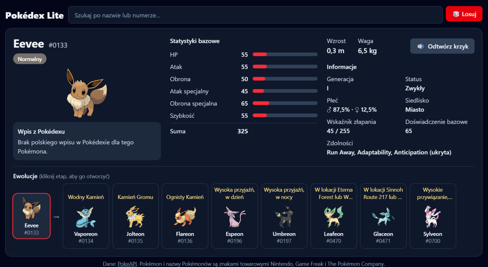

<div align="center">


# Pokédex Lite

**A fast, readable Pokédex in Polish and English – type a name or roll a random Pokémon and see everything on a single card.**




</div>

---

## ✨ Features

| | |
|---|---|
| 🔎 **Search** | Suggestions by name or number (`eev`, `133`, `#25`), full keyboard support. |
| 🎲 **Random** | A random Pokémon from #1–1025. The next one is prefetched in the background, so it shows up instantly. |
| 📊 **Stats** | All six base stats with bars and a total. |
| 🧬 **Evolutions** | The full tree, including branches (e.g. Eevee's eight evolutions), with readable conditions: stones, level, friendship, time of day, trade… Click any stage to open it on the card. |
| ℹ️ **Details** | Generation, status (legendary / mythical), gender ratio, habitat, catch rate, abilities. |
| 🔊 **Cry** | The Pokémon's cry on click (no autoplay). |
| 📖 **Pokédex entry** | The in-game description in the selected language, cleaned of special characters. |
| 🌐 **PL / EN** | A low-key language switch in the header. The choice is remembered; on the first visit the browser language decides. |

The whole card fits on a 15" laptop screen without scrolling; on phones it collapses into a single column.

## 🚀 Getting started

Requires **Node.js 20.19+** (or 22.12+).

```bash
npm install
npm run dev
```

The app runs at <http://localhost:5173>. No API keys, no backend.

### Scripts

| Command | Description |
|---|---|
| `npm run dev` | Dev server with hot reload |
| `npm run build` | Production build to `dist/` |
| `npm run preview` | Preview the production build |
| `npm test` | Unit tests (Vitest) |
| `npm run test:watch` | Tests in watch mode |

The build uses relative paths, so `dist/` can be dropped onto any static host, including a subdirectory (e.g. GitHub Pages).

## 🗂️ Project structure

```
src/
├── api/pokeapi.js          # PokeAPI requests + in-memory cache
├── components/
│   ├── Search.jsx          # search with suggestions (combobox)
│   ├── card/               # the Pokémon card and its sections
│   ├── evolution/          # evolution tree
│   └── ui/                 # spinner, error message, image, type badge
├── hooks/useAsync.js       # data loading with loading / ok / error states
├── i18n/                   # PL / EN dictionaries, language context, helpers
├── lib/                    # pure logic (formatting, evolution descriptions) + tests
├── App.jsx
└── main.jsx
```

## 🧠 Design notes

- **No data-fetching library.** A small promise cache in `api/pokeapi.js` is enough: each URL is fetched once per session, and failed requests can be retried.
- **Logic lives outside components.** Evolution condition descriptions, name formatting and text cleanup sit in `src/lib/` and are covered by tests.
- **Tiny i18n, no library.** Each language is a plain object in `src/i18n/messages/` (strings plus small functions for phrases with parameters), shared through a React context. A test checks that both dictionaries have the same keys. PokeAPI has no Polish names for types, items or habitats, so those are translated there too.
- **Accessibility.** Labelled buttons, alt text on images, an ARIA combobox for search, and animations disabled under `prefers-reduced-motion`.

## ⚠️ Data limitations

- **Polish Pokédex entries:** PokeAPI currently has no Polish descriptions, so in the Polish version the card usually shows a "no entry" message (switch to English to read the entry). The code will display Polish entries as soon as they appear.
- **Pokémon, ability and location names** are in English in both versions – that's the only form PokeAPI provides.
- **Cries** are `.ogg` files – Safari may not play them (the app shows a message in that case).

## 🙏 Credits

- Data and artwork: [PokeAPI](https://pokeapi.co) and [PokeAPI/sprites](https://github.com/PokeAPI/sprites).
- Pokémon and Pokémon character names are trademarks of Nintendo, Game Freak and The Pokémon Company. This is an unofficial, non-commercial project.
